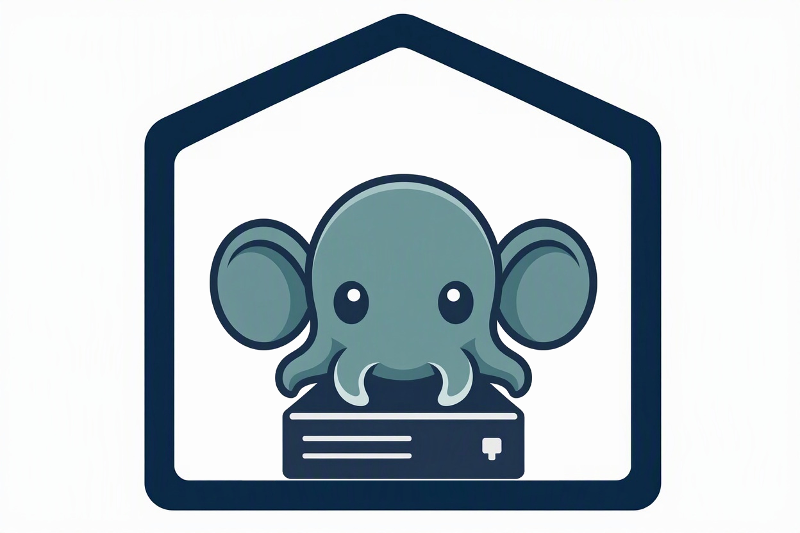

# DEN

**Digital Environment for Networking: your home server.**

Photos, files, movies and private remote access on one Fedora Server PC.
Use the apps from your phone or computer; no desktop is needed on the server.

  

## What You Get

- **Jellyfin** — watch movies, TV and music.
- **Immich** — upload and browse phone photos.
- **Nextcloud** — sync and share files.
- **Forgejo** — keep your Git projects at home.
- **WireGuard** — connect privately from your phone or computer.
- **Automatic backups and updates** — routine maintenance is built in.

**Optional:** qBittorrent for downloads, Fluxer for chat and calls, and a
KeePassXC-compatible password vault.

Everything runs on one Fedora Server PC, with access limited to your home
network and VPN.

## Start Here

**[Follow the setup checklist](docs/installation.md)** — one guide from preparing
the server to opening your apps. Print it or tick off the steps as you go.

## When You Need Help

- [Troubleshooting](docs/troubleshooting.md)
- [Downloads in Jellyfin](docs/qbittorrent.md)
- [Updates and maintenance](docs/operations.md)
- [Backup and recovery](docs/backup.md)
- [Access and privacy](docs/security.md)

**Version 1.0.0 — first home-server release.** Deployed and tested on bare-metal
Fedora Server. See [validation status](docs/testing.md#validation-status) for
what was checked and what remains. Keep another copy of files you cannot replace.
For contributors: [architecture](docs/architecture.md) and [testing](docs/testing.md).
